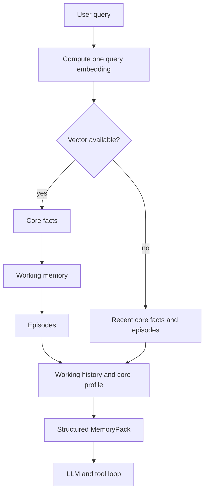

# MotiviAI engineering walkthrough

MotiviAI is an asynchronous Telegram assistant with persistent memory and calendar tools. This walkthrough focuses on a small, inspectable part of the backend: assembling a user's memory context for an LLM request.

## Follow the code

- [Memory orchestration](../app/services/memory_orchestrator.py): `MemoryOrchestrator.assemble` and `MemoryPack.to_context_dict`.
- [Core fact retrieval](../app/services/core_memory_service.py): joins facts, their embeddings and their owning user's memory; orders by pgvector cosine distance and applies top-k.
- [Working memory retrieval](../app/services/working_memory_service.py).
- [Episodic retrieval](../app/services/episodic_memory_service.py).
- [Conversation loop](../app/llm/conversation_service.py): passes the assembled context to the agent.



## Decisions and trade-offs

**Reuse the query vector.** The orchestrator obtains one embedding and passes that same vector to all three semantic retrieval services. The focused check verifies one embedding call and reuse across the three services. This is a call-count observation, not a measured claim about production cost or end-to-end latency.

**Keep work on a shared session sequential.** These service calls share an AsyncSession. The orchestrator awaits them in sequence instead of running concurrent queries on that session. A different design with separate sessions could make different trade-offs; the current design prioritizes predictable transaction/session ownership.

**Keep user scope explicit.** The user id is passed to each retriever. Core retrieval joins CoreMemory and filters on its user id. Working-history lookup also includes a user filter and a seven-row limit. The isolated check verifies the orchestrator passes this scope; it is not a replacement for database isolation tests.

**Fall back when no vector is returned.** An empty embedding result selects recent core facts and recent episodes, then ensures a working-memory record exists. This keeps a reduced context available. An embedding client exception is a separate case: the orchestrator itself does not catch it. The check makes that boundary explicit.

## Run the focused checks

From the repository root, with Python 3.11 or later:

```bash
python scripts/check_memory_contracts.py
```

The script uses the standard library only. It reads the unchanged MemoryPack and MemoryOrchestrator class definitions from their source with AST and supplies test doubles for their external collaborators. No API credentials, network, PostgreSQL or Redis are needed.

It checks:

1. One query embedding is reused by the three retrievers.
2. Service calls are sequential and working history is user-scoped.
3. An empty vector selects the recent-memory fallback.
4. A legacy retrieval signature without optional vector/top-k arguments remains supported.
5. An embedding exception is not silently counted as a successful fallback.
6. Working history is serialized in order.

On 1 November 2026, these six checks passed against source SHA-256 `0968f8f33a6df9120dde9bd46cabafe6cfe0c9645107b3bfca9a0fe1a96cdef6`, from revision `c0884384ed4e7bd1ddacbebc5a9cf7d42d32cb4c`.

## What this evidence covers

This is a reproducible component-level walkthrough. It does not certify the entire application, real database behavior, retrieval relevance, LLM answer quality, production load, latency or uptime.

To evaluate retrieval quality, the next separate experiment should use a versioned, manually judged question/fact set; record embedding model, data snapshot and retrieval settings; and compare Recall@k/MRR or nDCG. Latency measurements need a stated database setup, dataset size, concurrency and cache conditions. These measurements are not invented here.

The full application setup and existing pytest suite are documented in [README](../README.md) and [AGENTS.md](../AGENTS.md).
